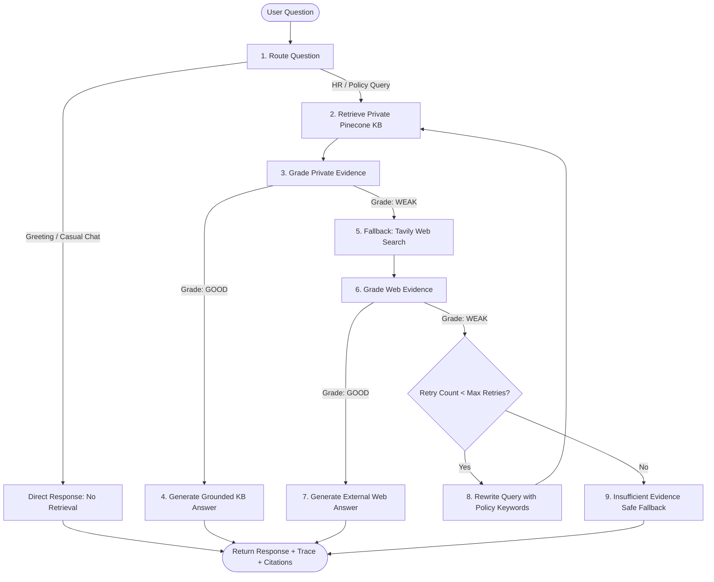

# Project Specification: Enterprise HR Policy & Employee Support Agentic RAG Copilot

## 1. System Overview & Business Problem
- **Organization**: PeoplePrime Technologies (a fictional company with 5,000 employees).
- **Domain**: Human Resources policies, benefits, attendance, leave, remote-work, payroll, onboarding, offboarding, code of conduct, and employee support.
- **Problem Statement**: Employees face friction finding authoritative answers across disparate internal HR documents. Off-the-shelf chatbots risk hallucinating policy details, exposing confidential company rules externally, or failing when fresh public labor regulations are needed.
- **Solution**: A production-grade, deterministic Agentic RAG copilot powered by LangGraph, FastAPI, Groq LLM, Pinecone Vector DB with local Hugging Face embeddings (`sentence-transformers/all-MiniLM-L6-v2`), Tavily Search fallback, and SQLite audit logging.

---

## 2. Architecture & Tech Stack

| Layer | Technology | Details & Purpose |
|---|---|---|
| **Frontend** | Semantic HTML5, CSS3 (Dark Theme), Vanilla JavaScript (ES6+) | Lightweight, zero-framework, responsive 3-panel UI: Navigation/Workflows, Interactive Chat, Real-Time Agent Decision Trace & Source Inspector. |
| **Backend API** | FastAPI (Python 3.14 / 3.10+) & Uvicorn | High-performance async REST API with Pydantic v2 data validation, structured error handling, and Swagger OpenAPI docs. |
| **Agent Orchestration** | LangGraph (`StateGraph`) | Explicit cyclic graph with conditional edges, query rewrite loops, evidence grading, and finite retry limits (max 1 retry) to prevent infinite loops. |
| **LLM Inference** | Groq API via `langchain-groq` (`ChatGroq`) | Ultra-fast inference using models such as `llama-3.3-70b-versatile` or `llama-3.1-8b-instant`. Strict temperature (0.0) for deterministic evaluation and extraction. |
| **Embedding Model** | Hugging Face `sentence-transformers/all-MiniLM-L6-v2` | Runs locally via `langchain-huggingface` / `sentence-transformers`. Output dimension: **384**. Cost-efficient, confidential, zero external embedding API latency. |
| **Vector Database** | Pinecone | Serverless index configured with dimension **384** and `cosine` distance metric. Namespace-isolated (`peopleprime-hr-kb`). |
| **Web Search Fallback** | Tavily Search API (`tavily-python` / `langchain-community`) | Targeted public domain search invoked *only* when internal evidence is graded as `weak`. External answers are explicitly disclaimed. |
| **Audit & Governance** | SQLite (`audit.db`) | Local ACID audit table logging timestamp, safe question, workflow stages, retrieval source type, evidence grades, retry count, final outcome, and latency. |
| **Document Processing** | PyPDF, python-docx, TextLoader | Modular text extraction pipeline for PDF, DOCX, TXT, and Markdown with recursive character chunking (chunk size 900, overlap 120). |
| **Containerization & Deployment** | Docker & DigitalOcean App Platform / Droplet | Multi-stage Docker container configured for production deployment. |

---

## 3. Agentic Workflow Architecture



### Core Decision Rules:
1. **Private KB Priority**: Internal HR knowledge base is always queried first. Tavily is never called if internal evidence is sufficient.
2. **Strict Grounding & Disclaimers**: External answers must be prominently flagged as external/public information requiring HR validation. Never portray web results as official PeoplePrime policy.
3. **Loop Prevention**: Maximum retry count strictly bounded to 1.
4. **Citation Authenticity**: Citations are derived exclusively from retrieved chunk metadata or verified web URLs. Never fabricated.
5. **Prompt Injection Defense**: Retrieved chunk content is passed into generation prompts as inert data blocks, never executable system instructions.

---

## 4. API Specification

### Endpoints:
- `GET /api/health`
  - Response: `{"status": "ok", "service": "...", "version": "1.0.0", "environment": "..."}`
- `POST /api/chat`
  - Request: `{"question": "How many days of annual leave do I get?"}`
  - Response:
    ```json
    {
      "answer": "...",
      "source_used": "private_kb" | "web_search" | "direct" | "insufficient_evidence",
      "trace": ["Router -> KB", "Private KB retrieval -> 4 chunks", "KB evidence grade -> GOOD", "..."],
      "citations": [{"title": "Leave_Policy_2026.pdf", "url": "", "type": "private_kb"}],
      "rewritten_query": "...",
      "latency_seconds": 0.85
    }
    ```
- `POST /api/ingest`
  - Headers: `X-Admin-Key: <SECRET_ADMIN_KEY>`
  - Form-data: `file: UploadFile`
  - Validation: Max size 15MB; extensions: `.pdf`, `.txt`, `.md`, `.docx`.
  - Response: `{"message": "Document indexed", "file": "...", "chunks": 12, "ids_created": 12}`
- `GET /api/audit/logs` (Optional admin inspection)
  - Headers: `X-Admin-Key: <SECRET_ADMIN_KEY>`
  - Response: Recent audit records for operational oversight.

---

## 5. Security & Governance Safeguards
1. **Zero Secret Leakage**: No API keys committed or returned to client. Clean `.env.example` provided. `.env` and SQLite DB files gitignored.
2. **Admin Authentication**: Document ingestion and maintenance endpoints require an administrative key passed via HTTP headers.
3. **PII & Audit Hygiene**: SQLite audit logs store query text, decision metrics, and latency without logging auth headers or raw system tokens.
4. **Resilient Fallback**: Graceful degradation when external search or vector DB connection times out or fails.
